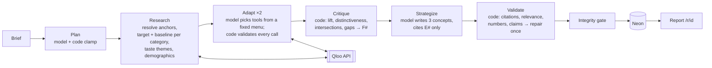

# Sondo

**Stop guessing what your audience loves.** Sondo is an autonomous cultural-intelligence strategist built for the [Qloo Agentic Hackathon 2026](https://qloo.devpost.com/). It turns a brand brief into three campaign concepts, and every cultural claim in them traces to a specific Qloo result you can open and inspect.

**Live demo:** https://sondo.xylolabs.space. No login: open a featured report, or write a brief and watch the agent research it live.

## The problem

Brand marketers and agency strategists pick cultural partners (creators, shows, podcasts, venues, co-brands) by gut feel or trend-chasing. LLM copilots make it worse: they produce confident, generic picks from training-data stereotypes, with no evidence and no audience specificity.

Sondo is for a brand or growth marketer at a DTC, CPG or hospitality brand without an insights team, and for agency strategists who need a defensible first-pass cultural brief.

## Why Qloo is essential

A plain LLM can't produce what Sondo shows, because the evidence comes from Qloo's taste graph and code, not from the model's memory:

- **Audience lift.** Every category runs twice: once with the brief's audience signals (age, gender, anchors, market) and once as a market baseline. What ranks higher for *this* audience than for the market is what Sondo surfaces.
- **Distinctiveness.** Qloo popularity crossed with in-query rank finds strong-fit entities that aren't mainstream.
- **Cross-category bridges.** The agent can seed a new Qloo query from a strong result in another category (brand → podcast → venue).
- **Provenance.** Each claim cites ledger items (`E1`, `E2` …) that were parsed from a real Qloo response. The report shows each item's Qloo category, rank and query, plus the full key-free tool trace.

Lift and distinctiveness are labelled **Sondo heuristics**. Affinity isn't purchase intent, audience share or ROI, and the product never says it is.

## How it works



- **Code owns** control flow, entity IDs, every number, budgets and status. **The model** plans, chooses follow-up research and writes copy.
- **Validation** (`lib/agent/validate.ts`, `lib/agent/relevance.ts`):
  - every `E#` must exist and must relate to the sentence that cites it;
  - evidence claims without a relevant citation become labelled hypotheses;
  - invented numbers and performance claims are removed;
  - concepts must differ.
- **Status is honest.** A run is `completed` only if all three concepts are grounded (≥ 3 relevant citations across ≥ 2 categories) and the integrity gate passes (`lib/runs/integrity.ts`). Anything else is stored as `partial`, `failed`, `cancelled` or `interrupted`, with the reason shown.
- **Budgets per run** (`lib/agent/budget.ts`): 24 Qloo calls, 4 model calls, 2 adaptive rounds, 180 s hard limit, concurrency 3.
- **Runs survive the client leaving.** A run executes under Next.js `after()`, streams NDJSON events to the browser, and persists to Postgres. Reloading mid-run resumes from the stored events.

### Qloo endpoints used

All calls go to `https://hackathon.api.qloo.com` (GET only), through a typed, allowlisted, budgeted client in `lib/qloo/`.

| Endpoint | Used for |
|---|---|
| `GET /search` | Resolve brand and cultural-anchor names to Qloo entities (trusted matches only) |
| `GET /v2/insights` (entity types: artist, movie, TV show, podcast, book, brand, place and more) | Cross-category affinity for the audience, plus the market baseline |
| `GET /v2/insights` `filter.type=urn:tag` | Taste themes behind the signal set |
| `GET /v2/insights` `filter.type=urn:demographics` | Age and gender affinity of anchors |

Capabilities were verified live; see [QLOO_RESEARCH.md](QLOO_RESEARCH.md) and the sanitized [`scripts/output/probe-summary.json`](scripts/output/probe-summary.json).

## What a judge can try

- **Featured reports** load instantly from the database, with every claim's `E#` chip opening the Qloo result behind it.
- **Watch the research**: each report replays its stored run in about 20 seconds (`/r/{id}/replay`). It's labelled as a replay and starts no new research.
- **Without Qloo, by contrast**: the same brief given to a plain language model with no data. Code matches its picks against the report's Qloo ledger and shows which ones Qloo surfaced for this audience, and which partners only Sondo found (`pnpm contrast`).
- **New brief**: a live run takes about two minutes and streams real Qloo queries.
- **Share**: every report link unfurls with its own preview image (brand, market, concepts, ledger size).

## Run it locally

Requirements: Node ≥ 22 (≥ 23.6 for `pnpm spike`) and pnpm.

```bash
pnpm install
cp .env.example .env.local   # fill in the keys below
pnpm db:migrate              # creates runs, run_events, qloo_cache (additive)
pnpm dev                     # http://localhost:3000
```

| Variable | Required | Notes |
|---|---|---|
| `QLOO_API_KEY` | Yes | Hackathon key; only `hackathon.api.qloo.com` is accepted. Server-only, never logged |
| `AI_GATEWAY_API_KEY` | Yes | Vercel AI Gateway. Set a spend budget on the key |
| `SONDO_MODEL` | No | Gateway model id, default `nvidia/nemotron-3.5-lightning-free` ($0) |
| `DATABASE_URL` | Yes | Neon Postgres for runs, reports and the private Qloo cache |
| `SONDO_IP_HASH_SECRET` | Yes for web runs | ≥ 32 chars; client IPs are stored only as HMACs |
| `SONDO_LIVE_RUNS` | No | `off` = featured reports only (quota kill switch) |
| `SONDO_RUNS_PER_IP_PER_DAY` / `SONDO_DAILY_RUN_CAP` / `SONDO_MAX_CONCURRENT_RUNS` | No | Defaults 5 / 40 / 2 |

See [.env.example](.env.example) for the full list.

### Commands

| Command | What it does |
|---|---|
| `pnpm lint` · `pnpm typecheck` · `pnpm test` | ESLint, TypeScript strict, Vitest (unit tests plus in-process Postgres via PGlite) |
| `pnpm build` · `pnpm start` | Production build |
| `pnpm e2e` | Playwright at 1280 and 375. Set `E2E_BASE_URL` to test a deployment and `E2E_LIVE=1` to add a live brief → report run |
| `pnpm eval` | Runs the 5 fixed briefs live and writes metrics only to `scripts/output/eval-summary.json` |
| `pnpm agent <brief>` | Runs the agent from the CLI on `scripts/briefs/*.json` |
| `pnpm featured <brief>[:rank]` | Runs briefs live and features them only if stored `completed` |
| `pnpm contrast <runId> … \| --featured` | Writes the "Without Qloo" panel for stored reports: one plain-model call per report, no Qloo calls, matched to the ledger in code |
| `pnpm probe` · `pnpm model:smoke` | Live Qloo capability probe and gateway model check |

### Deploy

It's a standard Next.js 16 app on Vercel (Node runtime). Set the environment variables above for Production, run `pnpm db:migrate` against the production database, then deploy. `POST /api/runs` uses `maxDuration = 300`.

## Data and honesty rules

- No Qloo response data is committed. Test fixtures are synthetic. Caches live only in the private database or the gitignored `.qloo-cache/`.
- The model never writes numbers. Every number in the UI is rendered from the ledger.
- Public run events never contain Qloo params, IDs, error strings or model-written reasoning (`toPublicEvent()`).
- Brief text and Qloo text are passed to the model as data, with injected instructions ignored, and the model's output is validated by code either way.

## Known limitations

- The default free model is flaky. A fair share of live runs end as an honest `partial` (fewer than three fully grounded concepts) rather than `completed`. A stronger `SONDO_MODEL` is the main quality lever.
- Live runs take about 1.5–3 minutes.
- Relevance checks are a deterministic consistency check (names, tags, categories), not fact-checking.
- Qloo models age buckets, binary gender, anchors and locality. Income, values or job titles in a brief are shown as "not modeled".
- The UI is light-only by design.

## Docs

[PRODUCT.md](PRODUCT.md) · [ARCHITECTURE.md](ARCHITECTURE.md) · [QLOO_RESEARCH.md](QLOO_RESEARCH.md) · [DESIGN.md](DESIGN.md) · [ROADMAP.md](ROADMAP.md) · [HACKATHON.md](HACKATHON.md) · [SUBMISSION.md](SUBMISSION.md)

## License

[MIT](LICENSE). Not affiliated with Qloo or any brand shown.
